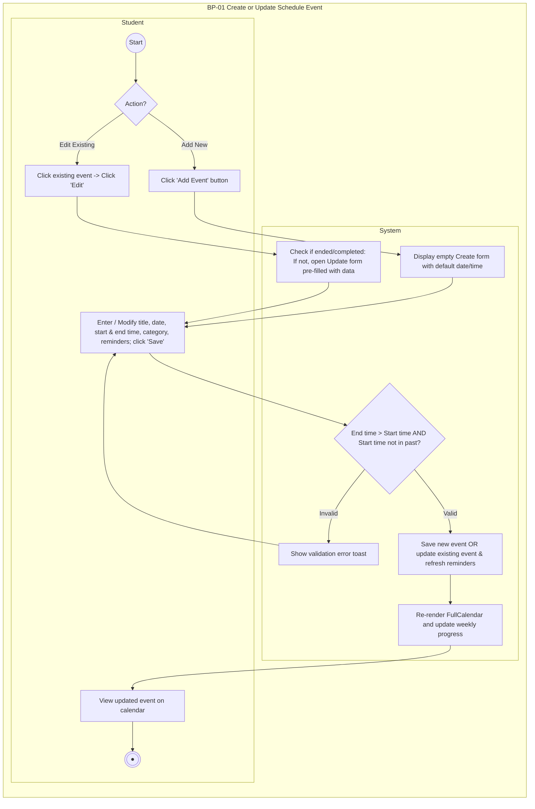
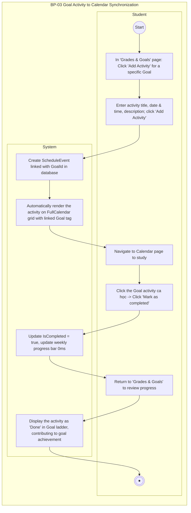

# Business Process Flows - Phân Hệ Calendar & Tích Hợp Mục Tiêu (StudyHub)

Tài liệu đặc tả các luồng nghiệp vụ (Business Process - BP) theo chuẩn **2-lane Swimlane (Student | System)**, thể hiện kiến trúc liên kết thực tế giữa **Lịch học (Calendar)** và **Mục tiêu học tập (Goals & Grades)**.

---

## 1. BP-01 Create or Update Schedule Event (Quản lý & Cập nhật Sự kiện)
*Gộp chung Thêm mới và Chỉnh sửa vào một luồng thống nhất vì dùng chung biểu mẫu và quy tắc kiểm tra thời gian.*



---

## 2. BP-02 Track Progress & Toggle Event Completion (Theo dõi & Đánh dấu Hoàn thành)
*Thể hiện tương tác trên giao diện FullCalendar, cơ chế phản hồi tức thì 0ms (Optimistic UI) và xử lý khi ca học bị quá hạn (Missed).*

```mermaid
flowchart TD
    subgraph BP02["BP-02 Track Progress & Toggle Event Completion"]
        direction TB
        subgraph Student["Student"]
            S2_Start((Start))
            S2_ClickEvent[Click on a scheduled event on Calendar grid]
            S2_ClickToggle[Click 'Mark as completed / Incomplete' button]
            S2_End(((●)))
        end

        subgraph System["System"]
            SYS2_ShowPop[Display event popover with details and reminders]
            SYS2_CheckPast{Event has already ended (past)?}
            SYS2_LockBtn[Disable toggle button with badge 'Missed', hide Edit button]
            SYS2_Optimistic[Immediately update UI 0ms: strike-through title and update weekly progress bar]
            SYS2_SaveDB[Persist new completion status to database in background]
            SYS2_CheckSave{Update success?}
            SYS2_Rollback[Revert UI to previous state and show error toast]
        end
    end

    S2_Start --> S2_ClickEvent
    S2_ClickEvent --> SYS2_ShowPop
    SYS2_ShowPop --> SYS2_CheckPast

    SYS2_CheckPast -- Yes --> SYS2_LockBtn
    SYS2_LockBtn --> S2_End

    SYS2_CheckPast -- No --> S2_ClickToggle
    S2_ClickToggle --> SYS2_Optimistic
    SYS2_Optimistic --> SYS2_SaveDB
    SYS2_SaveDB --> SYS2_CheckSave

    SYS2_CheckSave -- No --> SYS2_Rollback
    SYS2_Rollback --> S2_End

    SYS2_CheckSave -- Yes --> S2_End
```

---

## 3. BP-03 Goal Activity to Calendar Synchronization (Đồng bộ Mục Tiêu & Lịch Học)
*Luồng tích hợp liên phân hệ đắt giá nhất: Tạo hành động từ Mục tiêu điểm số $\rightarrow$ Tự động đồng bộ lên Lịch học $\rightarrow$ Học viên học và tick hoàn thành trên Lịch $\rightarrow$ Phản hồi tiến độ về Mục tiêu.*



---

## 4. Tóm tắt các điểm "ăn điểm" khi thuyết minh đồ án

1. **Sự kết hợp thông minh (Create / Update)**: Thay vì vẽ 2 sơ đồ trùng lặp, việc gộp thành **BP-01** thể hiện tư duy thiết kế tái sử dụng (Reusability) của hệ thống.
2. **Khóa bảo vệ dữ liệu lịch sử**: Hệ thống ngăn chặn việc sửa các sự kiện đã kết thúc hoặc đã hoàn thành, chỉ cho phép xóa để tránh gian lận lịch sử học tập.
3. **Tính liên kết liên phân hệ (Cross-module Integration - BP-03)**: Chứng minh tính nhất quán của hệ thống StudyHub: Học viên không phải tạo lịch học hai lần, mục tiêu điểm số gắn liền với hành động thực tế trên thời khóa biểu.
